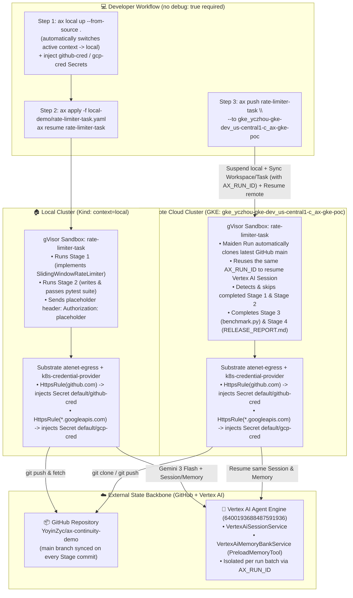

# AX Local-to-Cloud Continuity POC & Hands-On User Guide

> [!IMPORTANT]
> This guide provides a copy-pasteable **Hands-On Walkthrough (Step 0 -> Step 4)** demonstrating the complete local-to-cloud continuity lifecycle in AX: bootstrapping a local Kind cluster (`ax local up`), running an autonomous Google ADK coding agent inside a gVisor sandbox that pushes stage checkpoints to GitHub and Vertex AI, promoting the live task to a remote GKE cluster in one command (`ax push`), and watching the cloud sandbox seamlessly resume from the exact stage where the local cluster left off.

---

## 1. Architecture & Data Flow



---

## 2. Prerequisites

Before starting **Step 0**, ensure your local workstation and cloud environment satisfy the following prerequisites:

1. **Host Workstation Tooling**:
   - **Docker**: Running daemon (used by `ax local up` to provision the local Kind cluster and `localhost:5001` loopback registry; if `kind` is not installed on the host, `ax local up` automatically downloads `kind v0.32.0` to `~/.ax/bin/kind`).
   - **Go**: Used to build `./bin/ax` and cross-compile `ax-server` and `ax-task-runner` (`GOTOOLCHAIN=auto` handles toolchain version selection automatically).
   - **`kubectl` & `gcloud` CLI**: Authenticated with `gcloud auth application-default login` so you can mint 1-hour OAuth2 access tokens for Vertex AI.
2. **GitHub Repository & Fine-Grained PAT**:
   - Target repository: `https://github.com/YoyinZyc/ax-continuity-demo.git` (cloned locally at `/usr/local/google/home/yczhou/Projects/ax-continuity-demo`).
   - Local credential file `~/.ax/github_pat`: Contains a GitHub Fine-Grained Personal Access Token granted **`Repository permissions -> Contents: Read and write`** on `YoyinZyc/ax-continuity-demo`.
3. **Google Cloud Vertex AI Agent Engine**:
   - A managed **Vertex AI ReasoningEngine** instance in GCP project `yczhou-gke-dev` (`us-central1`, instance ID `6400193688487591936`) providing shared `VertexAiSessionService` and `VertexAiMemoryBankService` state across clusters.
4. **Remote GKE Target Cluster**:
   - Your local `kubeconfig` includes the remote GKE cluster context (`gke_yczhou-gke-dev_us-central1-c_ax-gke-poc`), with Agent Substrate and the AX control plane deployed via `ax install` (using an `ax-task-runner` image built with `google-adk[gcp]` and `pytest`).

---

## 3. Step-by-Step Hands-On User Guide

### Step 0: Reset Local & Remote Environments (Clean Kind Cluster + Remove Binary + Reset GitHub Repo)

This step:
1. Deletes any lingering `rate-limiter-task` on the remote GKE cluster;
2. Tears down the local Kind cluster (`local`), removes `./bin/ax`, and cleans `~/.ax` state;
3. Resets the `main` branch of `https://github.com/YoyinZyc/ax-continuity-demo.git` back to the initial unimplemented scaffold commit (`initial-scaffold` / `18490b8`).

```bash
# 1. Delete any leftover rate-limiter-task on the remote GKE cluster
cd /usr/local/google/home/yczhou/Projects/ax
./bin/ax --context gke_yczhou-gke-dev_us-central1-c_ax-gke-poc delete task rate-limiter-task 2>/dev/null || true

# 2. Delete the local Kind cluster (local) and remove the ./bin/ax binary
./bin/ax local delete 2>/dev/null || kind delete cluster --name local
rm -f ./bin/ax

# 3. Clean managed binaries, local cluster state, and active tunnel caches under ~/.ax (preserving ~/.ax/github_pat)
rm -rf ~/.ax/bin ~/.ax/local ~/.ax/tunnels

# 4. (Optional) Remove the local port-5001 container registry to replay a cold start
docker rm -f kind-registry 2>/dev/null || true

# 5. Verify clean state
docker ps --format "table {{.Names}}\t{{.Image}}\t{{.Status}}"
ls -la ~/.ax 2>/dev/null || echo "~/.ax is clean"

# 6. Reset GitHub repo YoyinZyc/ax-continuity-demo back to the initial scaffold commit (tag: initial-scaffold / 18490b8)
cd /usr/local/google/home/yczhou/Projects/ax-continuity-demo
PAT=$(cat ~/.ax/github_pat | tr -d '[:space:]')
AUTH_B64=$(printf "x-access-token:%s" "$PAT" | base64 -w0)
GIT_CONFIG_GLOBAL=/dev/null git -c http.extraHeader="Authorization: Basic ${AUTH_B64}" fetch origin --tags
git reset --hard initial-scaffold
GIT_CONFIG_GLOBAL=/dev/null git -c http.extraHeader="Authorization: Basic ${AUTH_B64}" push -f origin main
git log --oneline -n 2
```

**Expected Outcome of Step 0**:
- The local Kind container `local-control-plane` and `kind-registry` are removed, and `./bin/ax` is deleted.
- `git log` shows `origin/main` back at `18490b8 chore: initialize 4-stage ADK rate-limiter backlog and autonomous runner` (containing only `BACKLOG.md`, `agent_runner.py`, and the unimplemented `src/rate_limiter.py` skeleton).

---

### Step 1: Build the CLI, Run `ax local up`, and Configure Egress Credential Secrets

#### 1.1 Build `./bin/ax` and Stand Up the Local Environment (`ax local up --from-source .`)

```bash
cd /usr/local/google/home/yczhou/Projects/ax

# 1. Compile the ax CLI and set up a shell alias
GOTOOLCHAIN=auto go build -o ./bin/ax ./cmd/ax
alias ax="$PWD/bin/ax"

# 2. Bootstrap the local Kind cluster + Agent Substrate + AX control plane and task-runner images
GOTOOLCHAIN=auto ax local up --from-source .
```

**What `ax local up --from-source .` Does & Expected Output**:
```text
==> Creating local Kind cluster "local" (with local registry localhost:5001)...
==> Installing Agent Substrate v0.5.0 (local profile)...
==> Starting Substrate PostgreSQL and initializing mTLS roles...
==> Deploying Substrate control plane, router, and k8s-credential-provider...
==> Deploying gVisor WorkerPool (2 replica(s))...
==> Cross-compiling ax-server and ax-task-runner (linux/amd64) from /usr/local/google/home/yczhou/Projects/ax...
==> Building and pushing localhost:5001/ax-server:local...
==> Building and pushing localhost:5001/ax-task-runner:local...
==> Configuring Agent Substrate permissions for ax-system/ax-server...
==> Deploying ax-postgres in namespace "ax-system"...
==> Deploying ax-server (localhost:5001/ax-server:local@sha256:...) with default task image (localhost:5001/ax-task-runner:local@sha256:...)...
==> AX is ready in namespace "ax-system".

Local environment "local" is ready (active context: local).
```

> [!NOTE]
> `ax local up` completes four actions in a single command:
> 1. Starts the local container registry (`localhost:5001`) and the Kind node (`local-control-plane`);
> 2. Installs the full Agent Substrate stack (including the `atenet-egress` MITM proxy, `k8s-credential-provider` with its `NamespacePolicy` gating secrets by `ax.io/credential=true`, and the gVisor `ax-workers` `WorkerPool`);
> 3. Builds and pushes `ax-server` and `ax-task-runner` (pre-installed with `google-adk[gcp]` and `pytest`) from your local source tree;
> 4. Deploys `ax-postgres` and `ax-server`, and automatically switches your active `kubectl` context to `local`.

Verify the local stack status:
```bash
ax local status
```
Expected output:
```text
Cluster:         local (kind)
State:           Running
Kube Context:    local
Local Registry:  localhost:5001
Substrate:       Ready (v0.5.0)
AX Server:       Ready
```

#### 1.2 Configure Egress Credential Secrets (`github-cred` & `gcp-cred`) on Both Clusters

The sandboxed agent talks to two external cloud services while **keeping zero real credentials inside the sandbox container**:
- **`github-cred` (for `github.com:443`)**: Allows `git clone` and `git push` inside the sandbox to read and write `YoyinZyc/ax-continuity-demo`.
- **`gcp-cred` (for `*.googleapis.com:443`)**: Allows the ADK agent inside the sandbox to call three managed **Vertex AI** APIs (`gemini-3-flash-preview` model inference, `VertexAiSessionService`, and `VertexAiMemoryBankService`). Because a local Kind container has no GCP Metadata Server and no host ADC credentials are mounted into the sandbox—and because Vertex AI Agent Engine requires a Google Cloud OAuth2 Bearer token—`atenet-egress` intercepts `Authorization: Bearer placeholder` at the cluster egress boundary and swaps in the real token from `gcp-cred`.

Run the following loop to create and label both Secrets in the `default` namespace on both `local` and the remote GKE cluster:

```bash
PAT=$(cat ~/.ax/github_pat | tr -d '[:space:]')
AUTH_B64=$(printf "x-access-token:%s" "$PAT" | base64 -w0)
GCP_TOKEN=$(gcloud auth application-default print-access-token | tr -d '[:space:]')

for CTX in local gke_yczhou-gke-dev_us-central1-c_ax-gke-poc; do
  kubectl --context "$CTX" -n default create secret generic github-cred \
    --from-literal=token="$AUTH_B64" --dry-run=client -o yaml | kubectl --context "$CTX" apply -f -
  kubectl --context "$CTX" -n default label secret github-cred ax.io/credential=true --overwrite

  kubectl --context "$CTX" -n default create secret generic gcp-cred \
    --from-literal=token="$GCP_TOKEN" --dry-run=client -o yaml | kubectl --context "$CTX" apply -f -
  kubectl --context "$CTX" -n default label secret gcp-cred ax.io/credential=true --overwrite
done
```

---

### Step 2: Launch the Task Locally and Stream Stage 1 & Stage 2 Logs

`local-demo/rate-limiter-task.yaml` is configured with `AX_RUN_ID: "rate-limiter-run-003"` and a `25`-second pause after each stage (`STAGE_PAUSE_SECONDS: "25"`), giving you a comfortable window to run `ax push`.

> [!TIP]
> - Because `ax local up` already switched your active kubeconfig context to `local` (you can inspect or switch contexts anytime via `ax ctx` or `ax ctx <name>`), you **do not need `--context local`** when running commands against the local cluster.
> - **Mind the 1-hour TTL on `gcp-cred`**: OAuth2 access tokens minted by `gcloud auth application-default print-access-token` expire after **1 hour**. If more than an hour has elapsed since Step 1.2, re-run the Step 1.2 snippet to refresh `gcp-cred` before starting the task; otherwise Vertex AI calls will fail with `401 UNAUTHENTICATED (Token expired)`.

#### 2.1 Apply and Resume the Local Task
```bash
cd /usr/local/google/home/yczhou/Projects/ax
ax apply -f local-demo/rate-limiter-task.yaml
ax resume rate-limiter-task
```
Expected output:
```text
workspace.ax.io/demo-repo-ws created
task.ax.io/rate-limiter-task created
task.ax.io/rate-limiter-task resumed
```

#### 2.2 Stream Live Agent Logs from the Local Sandbox
Run the command below to follow the agent's progress in real time (note: `kubectl logs --all-pods=true` prepends a `[pod/ax-workers-.../worker] ` prefix to each JSON line, so `sed -u -n` is used to extract `[run=...]` progress messages and any `Error`/`ERROR` lines cleanly):
```bash
kubectl -n ate-workers logs deploy/ax-workers -f --all-pods=true \
  | sed -u -n 's/.*"message":"\([^"]*\(\[run=\|Error\|ERROR\)[^"]*\)".*/\1/p'
```
You will see the local sandbox output in order:
1. `🆕 Created brand-new Vertex AI Session: <SESSION_ID> (for run=rate-limiter-run-003)`
2. `▶️ Starting Stage 1/4 on cluster 'local'...` -> writes `src/rate_limiter.py` -> `🚀 Tool commit_and_push_stage: pushed commit ... -> origin/main` -> `💾 Stage 1/4 state synchronized to Vertex AI Session & Memory Bank!` (**At this point, the 1st new commit `Stage 1/4 [local]` is already live on GitHub `main`**)
3. `▶️ Starting Stage 2/4 on cluster 'local'...` -> writes `tests/test_rate_limiter.py` -> runs `pytest -v` (`passed`) -> `🚀 Tool commit_and_push_stage: pushed commit ... -> origin/main` -> `⏸️ Stage 2/4 checkpoint complete. Waiting 25s before Stage 3 (you can run 'ax push' now!)...` (**At this point, the 2nd new commit `Stage 2/4 [local]` is live on GitHub `main`**)

---

### Step 3: Promote the Task to Cloud GKE with `ax push`

> [!NOTE]
> **When are GitHub commits pushed vs. what does `ax push` do?**
> - **Git commits are pushed during Step 2 and Step 4** by the ADK agent inside the sandbox via its `commit_and_push_stage` tool at the end of each stage. Thus, Stage 1 and Stage 2 commits are already on GitHub before you run Step 3.
> - **Step 3 (`ax push`) is the AX control-plane migration command**: it suspends (checkpoints) the local `Task`, syncs the `Workspace` and `Task` manifests (preserving `AX_RUN_ID` and setting `AX_PROMOTED_FROM=local`) to the target GKE cluster, and resumes the remote `Task` so the GKE sandbox takes over for Stage 3 and Stage 4.

As soon as Stage 1 or Stage 2 prints `⏸️ Stage X/4 checkpoint complete. Waiting 25s...` (press `Ctrl+C` to exit the log stream, or use a second terminal), run:

```bash
cd /usr/local/google/home/yczhou/Projects/ax
alias ax="$PWD/bin/ax"
ax push rate-limiter-task --to gke_yczhou-gke-dev_us-central1-c_ax-gke-poc
```

**Expected Output**:
```text
==> [1/4] Fetching task "rate-limiter-task" from source context "local"...
==> [2/4] Suspending task "rate-limiter-task" on source context "local" (runID=rate-limiter-run-003)...
==> [3/4] Connecting to target context "gke_yczhou-gke-dev_us-central1-c_ax-gke-poc" and promoting manifest...
    workspace.ax.io/demo-repo-ws synced to gke_yczhou-gke-dev_us-central1-c_ax-gke-poc
    task.ax.io/rate-limiter-task created on gke_yczhou-gke-dev_us-central1-c_ax-gke-poc (AX_RUN_ID=rate-limiter-run-003)
==> [4/4] Resuming task "rate-limiter-task" on target context "gke_yczhou-gke-dev_us-central1-c_ax-gke-poc"...
==> Successfully pushed task.ax.io/rate-limiter-task from "local" to "gke_yczhou-gke-dev_us-central1-c_ax-gke-poc"!
```
*(If you run `ax get task rate-limiter-task` now, you will see the local Task's `PHASE` is `Suspended`.)*

---

### Step 4: Observe Stage 3 & Stage 4 Continuity on GKE and Verify GitHub Artifacts

#### 4.1 Stream Live Agent Logs from the Remote GKE Sandbox
```bash
kubectl --context gke_yczhou-gke-dev_us-central1-c_ax-gke-poc -n ate-workers logs deploy/ax-workers -f --all-pods=true \
  | sed -u -n 's/.*"message":"\([^"]*\(\[run=\|Error\|ERROR\)[^"]*\)".*/\1/p'
```
You will see the GKE sandbox output:
1. `🔄 Task was PROMOTED via 'ax push' from cluster 'local' -> 'gke_yczhou-gke-dev_us-central1-c_ax-gke-poc'!`
2. `🧠 Resumed existing Vertex AI Session: <SESSION_ID> (loaded ... prior events for run=rate-limiter-run-003)`
3. `📂 Detected already-committed stages in Git for run=rate-limiter-run-003: [1, 2]`
4. `⏭️ Skipping Stage 1/4 ...` & `⏭️ Skipping Stage 2/4 ...`
5. `▶️ Starting Stage 3/4 on cluster 'gke_yczhou-gke-dev_us-central1-c_ax-gke-poc'...` -> generates and runs `benchmark.py` -> pushes Stage 3 commit to GitHub
6. `▶️ Starting Stage 4/4 on cluster 'gke_yczhou-gke-dev_us-central1-c_ax-gke-poc'...` -> synthesizes `RELEASE_REPORT.md` -> pushes Stage 4 commit to GitHub -> `🎉 All 4 Stages completed! Task finished.`

#### 4.2 Pull the GitHub Repository to Inspect the Cross-Cluster Artifacts
```bash
cd /usr/local/google/home/yczhou/Projects/ax-continuity-demo
PAT=$(cat ~/.ax/github_pat | tr -d '[:space:]')
AUTH_B64=$(printf "x-access-token:%s" "$PAT" | base64 -w0)
GIT_CONFIG_GLOBAL=/dev/null git -c http.extraHeader="Authorization: Basic ${AUTH_B64}" pull --ff-only origin main

git log --oneline -n 5
cat PROGRESS.md
cat RELEASE_REPORT.md
```

---

## 4. Core Mechanics FAQ

### Q1: Why can we see the agent's logs without setting `spec.debug: true`?
- `spec.debug: true` only controls whether the in-sandbox **Guest SSH Server** is started (for interactive `ax ssh` sessions). The agent's progress logs in `agent_runner.py` are written to container **stdout** via `print(line, flush=True)`.
- In Agent Substrate, `stdout/stderr` from the `guest` container inside a gVisor sandbox is automatically captured by the hosting `ate-workers` pod and emitted as structured JSON log entries labeled with `"ate.actor.name": "rate-limiter-task"` and `"ate.actor.container.name": "guest"`. You can therefore stream them directly with `kubectl logs -n ate-workers deploy/ax-workers`.

### Q2: Is `sync to memory bank` managed autonomously by the LLM agent or by the harness?
- **It is managed deterministically by the ADK framework + stage harness in `agent_runner.py`, without relying on the LLM to remember to call a save tool**:
  1. **Automatic Session Append**: Whenever `runner.run_async(...)` executes a turn, ADK's `Runner` automatically appends the user prompt, tool calls, tool responses, and model output as events in `VertexAiSessionService`.
  2. **Stage-Boundary Memory Bank Consolidation (Write)**: At the end of each stage, `agent_runner.py` explicitly calls `await memory_svc.add_events_to_memory(..., custom_metadata={"wait_for_completion": True})` to extract and persist long-term memories from the session.
  3. **Automatic Memory Preloading (Read)**: The `Agent` is configured with ADK's built-in `PreloadMemoryTool()`, which automatically queries `VertexAiMemoryBankService` before each model turn and injects relevant memories from earlier stages into the system instruction.

### Q3: Why did the local sandbox only execute the first two stages (Stage 1 & 2)? Is there code blocking Stage 3 locally?
- Nothing in the code hard-codes "only run Stages 1 & 2 locally"—if you never run `ax push`, the local sandbox will run all four stages (`1 -> 2 -> 3 -> 4`) to completion.
- Execution stops after Stage 2 locally because we invoke `ax push` during the `STAGE_PAUSE_SECONDS` window after Stage 2. **Step 1 of `ax push` calls the `SuspendTask` RPC on the source cluster (`local`)** (see `cmd/ax/push_cmd.go`), which sends `SIGTERM` to the local process and checkpoints the gVisor actor, handing off the remaining stages to the remote GKE cluster.

### Q4: Does the remote `rate-limiter-task` on GKE use the same configuration as local, and how does it fetch the latest Git state?
- **Yes—the promoted `Workspace` and `Task` specs on GKE match the local specs** (with `AX_RUN_ID` preserved and `AX_CLUSTER_CONTEXT` updated to the target context). It picks up the latest Git commits through two complementary layers:
  1. **AX Workspace Maiden-Run Clone**: When `ax push` creates and resumes `rate-limiter-task` on GKE, `ax-task-runner` performs its initial workspace materialization and clones the latest `main` branch of `https://github.com/YoyinZyc/ax-continuity-demo.git` (which already includes the Stage 1 and Stage 2 commits pushed by `local`) into `/workspace/ax-continuity-demo`.
  2. **Idempotent Git Sync & Stage Detection in `agent_runner.py`**: On startup, `completed_stages_in_git()` runs `git fetch origin main && git reset --hard origin/main` and scans `git log` for commits tagged `[run:<AX_RUN_ID>]`. Seeing Stages 1 and 2 already committed, it skips them and starts directly at Stage 3.

---

## 5. Appendix

### 5.1 Complete `local-demo/rate-limiter-task.yaml` Manifest & Generator Command

If `local-demo/rate-limiter-task.yaml` is not yet present locally, you can generate it with:

```bash
mkdir -p /usr/local/google/home/yczhou/Projects/ax/local-demo
cat << 'EOF' > /usr/local/google/home/yczhou/Projects/ax/local-demo/rate-limiter-task.yaml
apiVersion: ax.io/v1alpha1
kind: Workspace
metadata:
  name: demo-repo-ws
spec:
  git:
    - name: origin
      repo: "https://github.com/YoyinZyc/ax-continuity-demo.git"
      branch: "main"
---
apiVersion: ax.io/v1alpha1
kind: Task
metadata:
  name: rate-limiter-task
spec:
  workspace:
    name: demo-repo-ws
  command:
    - python3
    - -u
    - /workspace/ax-continuity-demo/agent_runner.py
  env:
    - name: GOOGLE_GENAI_USE_VERTEXAI
      value: "TRUE"
    - name: GOOGLE_CLOUD_PROJECT
      value: "yczhou-gke-dev"
    - name: GOOGLE_CLOUD_LOCATION
      value: "global"
    - name: VERTEX_ENGINE_LOCATION
      value: "us-central1"
    - name: AGENT_ENGINE_ID
      value: "6400193688487591936"
    - name: AX_RUN_ID
      value: "rate-limiter-run-003"
    - name: AX_CLUSTER_CONTEXT
      value: "local"
    - name: STAGE_PAUSE_SECONDS
      value: "25"
EOF
```

| Field | Description |
| :--- | :--- |
| `Workspace.spec.git[0].repo` | Remote GitHub repository cloned into `/workspace/ax-continuity-demo` on sandbox maiden run |
| `Task.spec.command` | Autonomous ADK coding runner executed automatically on container startup (no `debug: true` or manual `ax ssh` needed) |
| `AGENT_ENGINE_ID` | Managed Vertex AI ReasoningEngine ID backing `VertexAiSessionService` and `VertexAiMemoryBankService` |
| `AX_RUN_ID` | Unique batch identifier isolating Vertex AI Sessions and Git stage commits across runs; preserved by `ax push` |
| `AX_CLUSTER_CONTEXT` | Cluster label recorded in commits and logs; automatically updated to the target context by `ax push --to <target>` |
| `STAGE_PAUSE_SECONDS` | Checkpoint pause window (default `25` seconds) after each stage completes, giving you time to run `ax push` |

---

### 5.2 Verified Cross-Cluster Continuity Record (`run=rate-limiter-run-002`)

Verified commit history on GitHub `origin/main`:
```text
72cabd6 feat(stage-4): publish cross-cluster RELEASE_REPORT.md [cluster:gke_yczhou-gke-dev_us-central1-c_ax-gke-poc] [run:rate-limiter-run-002]
c522ebe feat(stage-3): run cloud throughput benchmark on GKE [cluster:gke_yczhou-gke-dev_us-central1-c_ax-gke-poc] [run:rate-limiter-run-002]
44bf378 feat(stage-2): add unit test suite and verify pytest passes [cluster:local] [run:rate-limiter-run-002]
5fc3a8b feat(stage-1): implement thread-safe SlidingWindowRateLimiter [cluster:local] [run:rate-limiter-run-002]
18490b8 (tag: initial-scaffold) chore: initialize 4-stage ADK rate-limiter backlog and autonomous runner
```

Generated `PROGRESS.md`:
```markdown
# Autonomous Agent Execution Progress

| Stage | Cluster | Run ID | Timestamp | Summary |
| :--- | :--- | :--- | :--- | :--- |
| Stage 1 | `local` | `rate-limiter-run-002` | 2026-11-06 17:54:39 UTC | implement thread-safe SlidingWindowRateLimiter |
| Stage 2 | `local` | `rate-limiter-run-002` | 2026-11-06 17:55:29 UTC | add unit test suite and verify pytest passes |
| Stage 3 | `gke_yczhou-gke-dev_us-central1-c_ax-gke-poc` | `rate-limiter-run-002` | 2026-11-06 17:56:45 UTC | run cloud throughput benchmark on GKE |
| Stage 4 | `gke_yczhou-gke-dev_us-central1-c_ax-gke-poc` | `rate-limiter-run-002` | 2026-11-06 17:57:39 UTC | publish cross-cluster RELEASE_REPORT.md |
```
